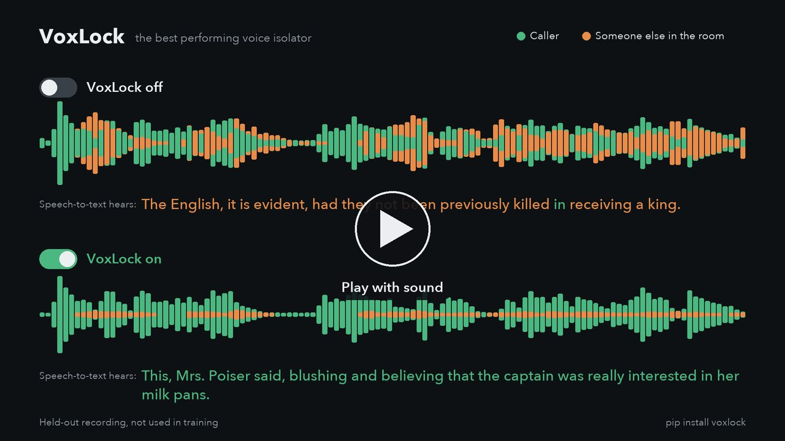

# VoxLock

**The best performing voice isolator there is.** VoxLock is an open-source voice isolation model: it keeps the caller's voice and removes the other voices in the room before speech-to-text hears them. Made for voice agents and phone calls: one input, the call audio, and it picks out the caller by itself. It streams on a CPU with 24 ms of algorithmic latency.

**[Live demo](https://arbazsiddiqui.me/voxlock)** · **[Model on Hugging Face](https://huggingface.co/arbazsiddiqui/voxlock)**

<p>
  <a href="https://pypi.org/project/voxlock/"></a>
  <a href="https://huggingface.co/arbazsiddiqui/voxlock"></a>
  <a href="#results"></a>
  <a href="LICENSE"></a>
</p>

<a href="assets/demo.mp4"></a>

## Results


| Model | Access | Word error rate % | Background words leaked / min |
|---|---|---|---|
| **VoxLock** | **open** | **4.95** | **0.11** |
| Krisp VI 2.5 Default | paid | 5.30 | 1.52 |
| Krisp VI 2.5 Balanced | paid | 5.32 | 2.02 |
| Krisp VI 2.5 HD | paid | 5.79 | 2.74 |
| Krisp VI 2.5 Lite | paid | 6.21 | 4.52 |
| ai-coustics Voice Focus 2.2 L | paid | 6.84 | 0.66 |
| ai-coustics Voice Focus 2.2 S | paid | 6.91 | 1.00 |
| Sanas Voice Isolation SE 1.0 | paid | 9.38 | 13.76 |
| REAL-TSE causal (VoxLock's starting checkpoint) | open | 9.81 | 13.73 |
| Hush | open | 12.09 | 19.58 |
| DeepFilterNet3 | open | 13.30 | 22.77 |
| TIGER | open | 14.72 | 37.24 |
| No processing | | 23.21 | 66.48 |
| SAM-Audio small (Meta) | open | 33.77 | 21.15 |
| ElevenLabs Voice Isolator\*\* | paid | 43.79\*\* | 144.6\*\* |

265 real recordings from the [Krisp Voice Isolation Benchmark](https://huggingface.co/datasets/Krisp-AI/VoiceIsolation-Benchmark-Dataset), transcribed with Parakeet TDT 0.6B v2 and scored with the benchmark's published method. **Background words leaked** counts words transcribed while only the background was talking, per minute of that audio.

\*\* ElevenLabs Voice Isolator, run on the 7 of these recordings with the most background speech, not all 265. On the same 7, no processing scores 45.82% and 154.3 leaked words per minute, and VoxLock 2.98% and 0.0.

On real AMI meetings not used in training, with the headset wearer as the caller:

| Model | Access | Word error rate % | Background words leaked / min |
|---|---|---|---|
| **VoxLock** | **open** | **10.12** | 2.12 |
| ai-coustics Voice Focus 2.2 S | paid | 11.85 | **1.06** |
| ai-coustics Voice Focus 2.2 L | paid | 12.13 | 1.72 |
| Sanas Voice Isolation SE 1.0 | paid | 13.30 | 5.30 |
| TIGER | open | 22.84 | 36.85 |
| DeepFilterNet3 | open | 26.78 | 38.84 |
| Hush | open | 33.00 | 68.93 |
| No processing | | 33.03 | 78.34 |

Caller words missed, deletions, insertions and 95% intervals: [bench/results](bench/results).

## Use

```bash
pip install voxlock
voxlock call.wav -o caller.wav
```

Any sample rate, mono or stereo. The model, 50 MB, downloads from Hugging Face on first use.

```python
import voxlock

vl = voxlock.VoxLock()
call = voxlock.load_audio("call.wav")      # 16 kHz mono float32
caller = vl.isolate(call)                  # same length as the input
```

VoxLock keeps the voice in a 3-second sample of the caller. `isolate` takes the loudest 3 seconds in the first 15 seconds of the call, which is how it was benchmarked. Pass `sample=` to choose it yourself.

### Live calls

```python
stream = vl.stream(sample)                 # about 3 s of the caller, 16 kHz mono
for chunk in call_audio:                   # 16 kHz float32 chunks of any size
    send(stream.push(chunk))               # the isolated audio, about 24 ms behind
send(stream.flush())                       # at the end of the call
```

The stream needs the sample before it starts. In a voice agent, take the first 3 seconds the caller speaks, or a sample saved from an earlier call, and pass the audio through until then. Streaming gives the same output as `isolate`. With 4 CPU threads on an Apple M2 Pro it runs in real time from 40 ms chunks (`VoxLock(threads=4)`).

### PyTorch

```bash
git clone https://github.com/arbazsiddiqui/voxlock && cd voxlock
pip install -r requirements.txt
huggingface-cli download arbazsiddiqui/voxlock model.safetensors config.yaml --local-dir ckpt
python isolate.py --ckpt ckpt --in call.wav --out caller.wav
```

## Training

A 27M causal band-split RNN target-speaker extractor, fine-tuned from the [REAL-TSE challenge baseline](https://github.com/REAL-TSE/wesep-real-tse) on a single NVIDIA L4:

```
REAL-TSE tfmap_context_causal_100
  -> simulated calls        4,000 steps   LibriSpeech callers + background talkers in simulated rooms
  -> real AMI crosstalk     4,000 steps   headset recordings from 40 meetings
  -> long calls (30 s)        800 steps   callers who talk throughout
  -> rooms and distances     400 steps   callers near or far from the mic, background voices dry or in the room, room noise
```

## Repository

| Path | |
|---|---|
| `voxlock/` | the `pip install voxlock` package: whole files, streaming, command line |
| `isolate.py` | PyTorch inference |
| `export_onnx.py` | ONNX export |
| `demo/` | the browser demo (`python demo/serve.py`) |
| `bench/` | benchmark harness, vendor runners, per-file results |
| `train/` | training scripts and data preparation |

## Acknowledgements

Built on the REAL-TSE challenge baseline and [WeSep](https://github.com/wenet-e2e/wesep) by Shuai Wang, Ke Zhang and co-authors, with [WeSpeaker](https://github.com/wenet-e2e/wespeaker)'s ECAPA model. Trained on [LibriSpeech](https://www.openslr.org/12) and the [AMI Meeting Corpus](https://groups.inf.ed.ac.uk/ami/corpus/).

## License

Apache-2.0.
