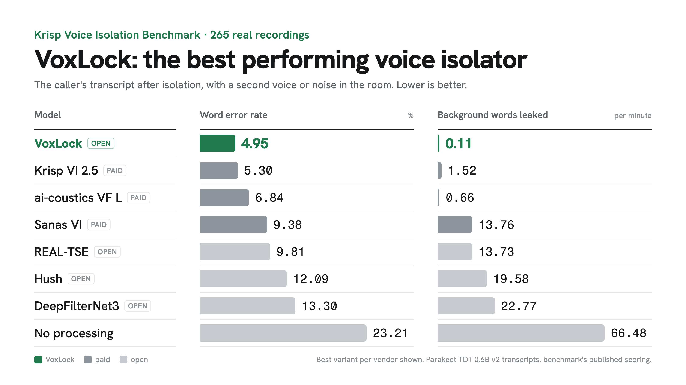

# VoxLock

**The best performing voice isolator there is.** VoxLock is an open-source voice isolation model: it keeps the caller's voice and removes the other voices in the room before speech-to-text hears them. Made for voice agents and phone calls: one input, the call audio, and it picks out the caller by itself. It streams on a CPU with 24 ms of algorithmic latency, and plugs into [Pipecat](#pipecat) and [LiveKit](#livekit) voice agents.

**[Write-up](https://arbazsiddiqui.me/voxlock)** · **[Model on Hugging Face](https://huggingface.co/arbazsiddiqui/voxlock)** · **[Try it in your browser](https://huggingface.co/spaces/arbazsiddiqui/voxlock)**

<p>
  <a href="https://pypi.org/project/voxlock/"></a>
  <a href="https://huggingface.co/arbazsiddiqui/voxlock"></a>
  <a href="#results"></a>
  <a href="LICENSE"></a>
  <a href="#livekit"></a>
  <a href="#pipecat"></a>
  <a href="https://github.com/arbazsiddiqui/voxlock/actions/workflows/tests.yml"></a>
</p>

https://github.com/user-attachments/assets/d32cf251-b461-4a91-93b1-21a8bd6ad840

## Results



| Model | Access | Word error rate % | Background words leaked / min |
|---|---|---|---|
| **VoxLock** | **open** | **4.95** | **0.11** |
| Krisp VI 2.5 Default | paid | 5.30 | 1.52 |
| Krisp VI 2.5 Balanced | paid | 5.32 | 2.02 |
| Krisp VI 2.5 HD | paid | 5.79 | 2.74 |
| Krisp VI 2.5 Lite | paid | 6.21 | 4.52 |
| ai-coustics Voice Focus 2.2 L | paid | 6.84 | 0.66 |
| ai-coustics Voice Focus 2.2 S | paid | 6.91 | 1.00 |
| Sanas Voice Isolation SE 1.0 | paid | 9.38 | 13.76 |
| REAL-TSE causal (VoxLock's starting checkpoint) | open | 9.81 | 13.73 |
| Hush | open | 12.09 | 19.58 |
| DeepFilterNet3 | open | 13.30 | 22.77 |
| TIGER | open | 14.72 | 37.24 |
| No processing | | 23.21 | 66.48 |
| SAM-Audio small (Meta) | open | 33.77 | 21.15 |
| ElevenLabs Voice Isolator\*\* | paid | 43.79\*\* | 144.6\*\* |

265 real recordings from the [Krisp Voice Isolation Benchmark](https://huggingface.co/datasets/Krisp-AI/VoiceIsolation-Benchmark-Dataset), transcribed with Parakeet TDT 0.6B v2 and scored with the benchmark's published method. **Background words leaked** counts words transcribed while only the background was talking, per minute of that audio.

\*\* ElevenLabs Voice Isolator, run on the 7 of these recordings with the most background speech, not all 265. On the same 7, no processing scores 45.82% and 154.3 leaked words per minute, and VoxLock 2.98% and 0.0.

On real AMI meetings not used in training, with the headset wearer as the caller:

| Model | Access | Word error rate % | Background words leaked / min |
|---|---|---|---|
| **VoxLock** | **open** | **10.12** | 2.12 |
| ai-coustics Voice Focus 2.2 S | paid | 11.85 | **1.06** |
| ai-coustics Voice Focus 2.2 L | paid | 12.13 | 1.72 |
| Sanas Voice Isolation SE 1.0 | paid | 13.30 | 5.30 |
| TIGER | open | 22.84 | 36.85 |
| DeepFilterNet3 | open | 26.78 | 38.84 |
| Hush | open | 33.00 | 68.93 |
| No processing | | 33.03 | 78.34 |

Caller words missed, deletions, insertions and 95% intervals: [bench/results](bench/results).

## Use

For voice agents: a [Pipecat](#pipecat) audio filter, a [LiveKit](#livekit) Agents plugin, and [sherpa-onnx](#sherpa-onnx) in C++. For files and your own streaming loop, read on.

```bash
pip install voxlock
voxlock call.wav -o caller.wav
```

Any sample rate, mono or stereo. The model downloads from Hugging Face on first use: 74 MB, the 8-bit version (see [Quantized models](#quantized-models)). `voxlock download` fetches it ahead of time, e.g. while building a Docker image.

```python
import voxlock

vl = voxlock.VoxLock()                     # precision="fp32" for the benchmarked model
call = voxlock.load_audio("call.wav")      # 16 kHz mono float32
caller = vl.isolate(call)                  # same length as the input
```

VoxLock keeps the voice in a 3-second sample of the caller. `isolate` takes the loudest 3 seconds in the first 15 seconds of the call, which is how it was benchmarked. Pass `sample=` to choose it yourself: at least 3 seconds, and a longer sample gives its loudest 3 seconds in the first 30.

### Streaming

Push the call in as it arrives, as 16 kHz float32 chunks of any size. Each `push` returns the isolated audio that is ready, about 24 ms behind the input.

```python
vl = voxlock.VoxLock(threads=1)
stream = vl.live()                         # finds the caller by itself
for chunk in call_audio:                   # e.g. 40 ms = 640 samples
    send(stream.push(chunk))
send(stream.flush())                       # at the end of the call
```

`live()` passes the audio through unchanged until it has heard 3 seconds of speech, takes that speech as the voice sample and isolates from then on. On our test calls it switched over a median of 3.6 seconds in. At the switch it first runs the model over the call so far (up to 30 seconds), so the model never starts cold in the middle of a sentence; that is a one-time 2 to 5 seconds of work on one CPU thread. On the 265 Krisp recordings `live()` scores 5.15% word error rate with the `fp32` model, against 4.95% on the whole file.

If you already have a sample, from earlier in the call or from a previous call, isolation starts with the first chunk:

```python
stream = vl.stream(sample)                 # about 3 s of the caller, 16 kHz mono
```

Streaming gives the same output as `isolate` with the same sample, to float rounding with `fp32`; `int8` differs slightly, since its 8-bit scaling depends on the chunk size. On one CPU thread it keeps up with chunks of 40 ms or more, and with 20 ms chunks on two threads (see [Performance](#performance)). Larger chunks use less CPU and add their length to the delay.

### Pipecat

```bash
pip install "voxlock[pipecat]"
```

```python
from pipecat.transports.base_transport import TransportParams
from voxlock.pipecat import VoxLockFilter

params = TransportParams(audio_in_enabled=True, audio_in_filter=VoxLockFilter())
```

Passes audio through until it has heard 3 seconds of the caller, then isolates (`voice_sample=` isolates from the start). Any transport rate, Twilio's 8 kHz included. One thread, 61% of a CPU core, 184 ms delay at 16 kHz; `chunk_ms=40` gives 104 ms for 77%. Example: [examples/pipecat_bot.py](examples/pipecat_bot.py). Tested with Pipecat 1.15.0.

### LiveKit

```bash
pip install "voxlock[livekit]"            # or: pip install livekit-plugins-voxlock
```

```python
from livekit.agents import room_io
from voxlock.livekit import VoxLockFilter   # or: from livekit.plugins import voxlock; voxlock.VoxLockFilter()

await session.start(
    agent,
    room=ctx.room,
    room_options=room_io.RoomOptions(
        audio_input=room_io.AudioInputOptions(sample_rate=16000, noise_cancellation=VoxLockFilter()),
    ),
)
```

One filter per session. Passes audio through until it has heard 3 seconds of the caller, then isolates (`voice_sample=` isolates from the start). One thread, about 68% of a CPU core, 124 ms delay at 16 kHz. Call `preload()` in your prewarm function; `download-files` fetches the model. Example: [examples/livekit_agent.py](examples/livekit_agent.py). Tested with livekit-agents 1.8.10.

### sherpa-onnx

VoxLock is built into the speech denoisers of [sherpa-onnx](https://github.com/k2-fsa/sherpa-onnx) from version 2.0.1, in C++ with no Python, for whole files and for streams. Download the models with sherpa-onnx's meta data from [this release](https://github.com/arbazsiddiqui/voxlock/releases/tag/sherpa-onnx-models), then:

```bash
sherpa-onnx-offline-denoiser \
  --speech-denoiser-voxlock-enroll-model=voxlock_enroll.onnx \
  --speech-denoiser-voxlock-chunk-model=voxlock_chunk_int8.onnx \
  --input-wav=call.wav --output-wav=caller.wav
```

`sherpa-onnx-online-denoiser` takes the same models and streams. Both take the voice sample from the audio as this package does; `--speech-denoiser-voxlock-voice-sample=caller.wav` gives it instead.

### PyTorch

```bash
git clone https://github.com/arbazsiddiqui/voxlock && cd voxlock
pip install -r requirements.txt
huggingface-cli download arbazsiddiqui/voxlock model.safetensors config.yaml --local-dir ckpt
python isolate.py --ckpt ckpt --in call.wav --out caller.wav
```

## Performance

One live call through `VoxLock.stream` with the default `int8` model on one CPU thread: onnxruntime 1.31.1 on a Google Cloud g2-standard-8 (Intel Xeon @ 2.20 GHz), 60 seconds of AMI meeting audio.

| Chunk | CPU per call | Real-time factor |
|---|---|---|
| 20 ms | 110% of a core | 1.10 |
| 40 ms | 77% of a core | 0.77 |
| 80 ms | 61% of a core | 0.61 |

Below 1 keeps up with the call. 20 ms chunks keep up on two threads (0.86). The model has 27M parameters and 24 ms of algorithmic latency, plus the chunk. On the same machine's NVIDIA L4 GPU (`fp32`, CUDA), a whole recording runs 40 times faster than real time.

## Quantized models

The ONNX model comes in four precisions, all in the [Hugging Face repository](https://huggingface.co/arbazsiddiqui/voxlock/tree/main/onnx/v2). Choose with `VoxLock(precision=...)`, `voxlock --precision ...` or `VoxLockFilter(precision=...)`.

| Precision | Quality | Files | Download | Word error rate % | Background words leaked / min | CPU per call, 20 ms chunks |
|---|---|---|---|---|---|---|
| `int8` (default) | 99.8% | `enroll.onnx`, `chunk_int8.onnx` | 74 MB | 5.11 | 0.12 | 110% |
| `int8-full` | 99.1% | `enroll.onnx`, `chunk_int8_full.onnx` | 71 MB | 5.85 | 0.04 | 110% |
| `fp16` | 100%\* | `enroll_fp16.onnx`, `chunk_fp16.onnx` | 47 MB | 4.95\* | 0.11\* | 163% |
| `fp32` | 100% | `enroll.onnx`, `chunk.onnx` | 94 MB | 4.95 | 0.11 | 165% |

Quality: the share of `fp32`'s correctly transcribed words each precision keeps, on the 265 Krisp recordings. CPU per call: one live call on one thread of the Xeon in [Performance](#performance).

\* `fp16` is the float32 model with its weights rounded to float16. Its output matches float32 to over 70 dB, so it carries the float32 scores. The browser demo uses it.

`enroll` runs once on the voice sample, `chunk` runs on each chunk of the call and carries the LSTM state.

## Training

A 27M causal band-split RNN target-speaker extractor, fine-tuned from the [REAL-TSE challenge baseline](https://github.com/REAL-TSE/wesep-real-tse) on a single NVIDIA L4:

```
REAL-TSE tfmap_context_causal_100
  -> simulated calls        4,000 steps   LibriSpeech callers + background talkers in simulated rooms
  -> real AMI crosstalk     4,000 steps   headset recordings from 40 meetings
  -> long calls (30 s)        800 steps   callers who talk throughout
  -> rooms and distances     400 steps   callers near or far from the mic, background voices dry or in the room, room noise
```

## Repository

| Path | |
|---|---|
| `voxlock/` | the `pip install voxlock` package: whole files, streaming, command line, Pipecat and LiveKit filters |
| `integrations/` | `livekit-plugins-voxlock`, the LiveKit plugin package |
| `examples/` | Pipecat and LiveKit voice agents with VoxLock |
| `tests/` | unit tests, and the Pipecat and LiveKit filters run as each framework runs them |
| `isolate.py` | PyTorch inference |
| `export_onnx.py` | ONNX export |
| `demo/` | the browser demo (`python demo/serve.py`) |
| `bench/` | benchmark harness, vendor runners, per-file results |
| `train/` | training scripts and data preparation |

## Acknowledgements

Built on the REAL-TSE challenge baseline and [WeSep](https://github.com/wenet-e2e/wesep) by Shuai Wang, Ke Zhang and co-authors, with [WeSpeaker](https://github.com/wenet-e2e/wespeaker)'s ECAPA model. Trained on [LibriSpeech](https://www.openslr.org/12) and the [AMI Meeting Corpus](https://groups.inf.ed.ac.uk/ami/corpus/).

## License

Apache-2.0.
